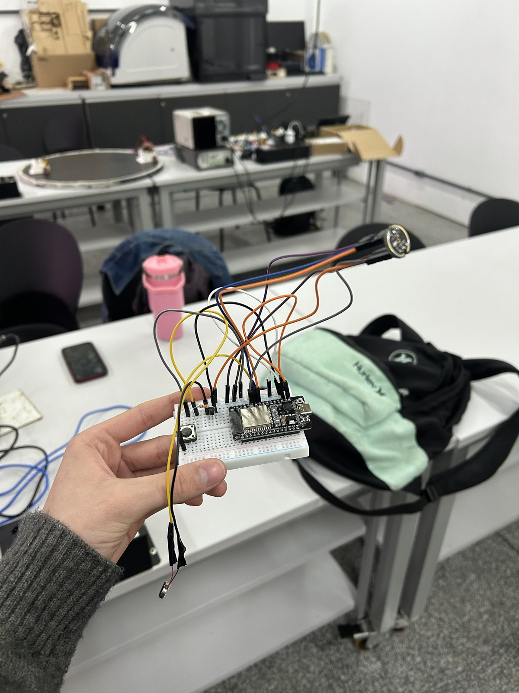
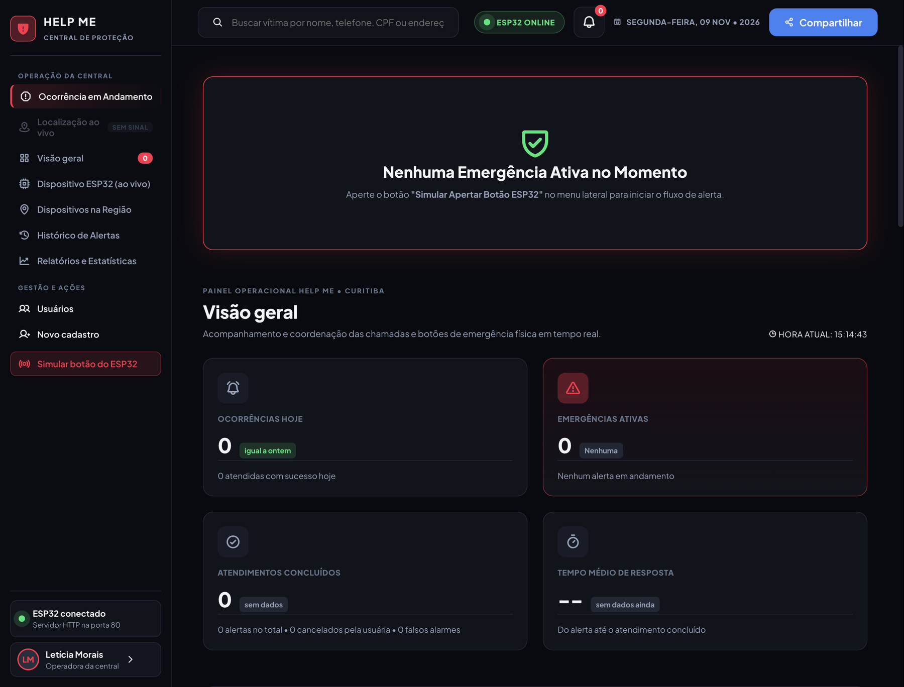
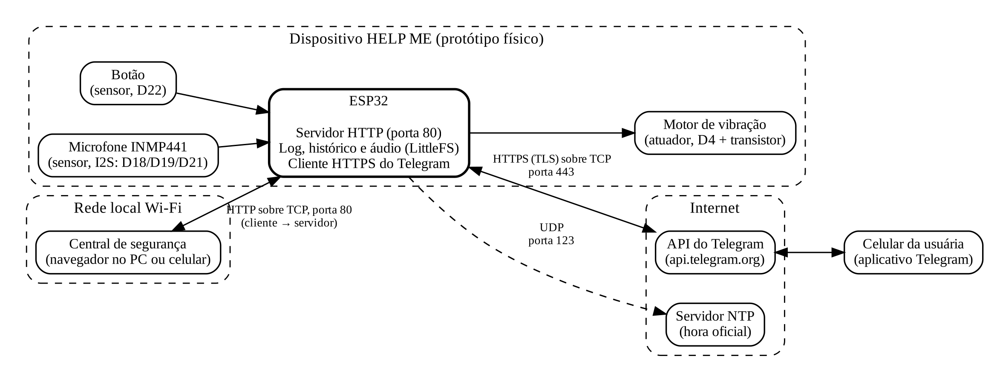
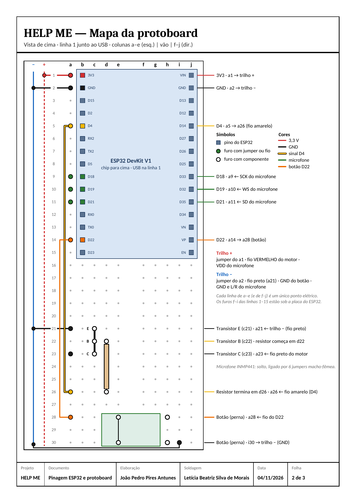
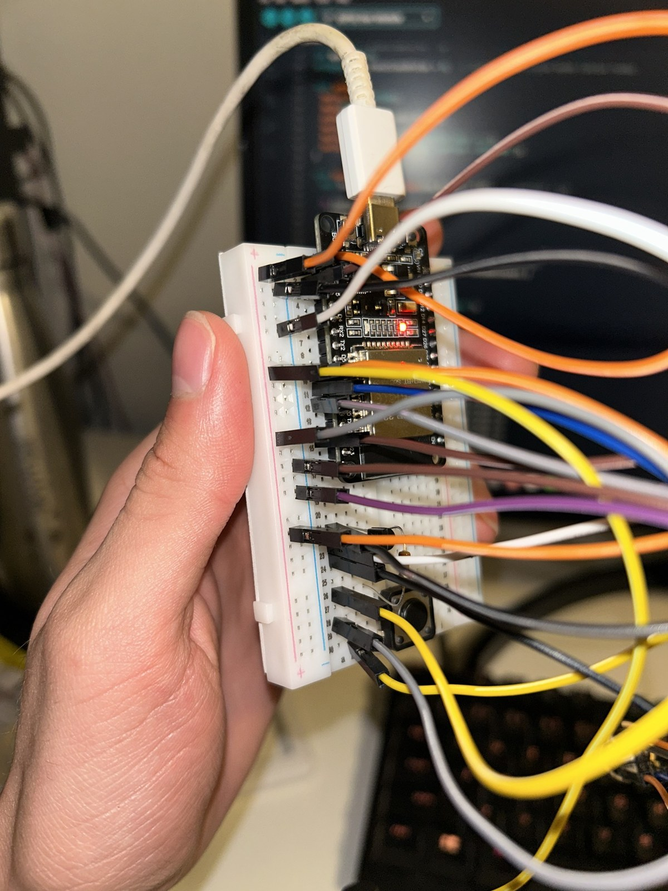
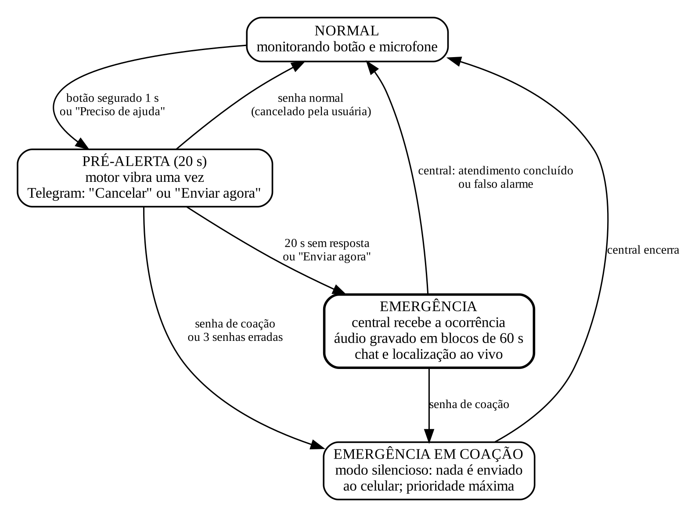
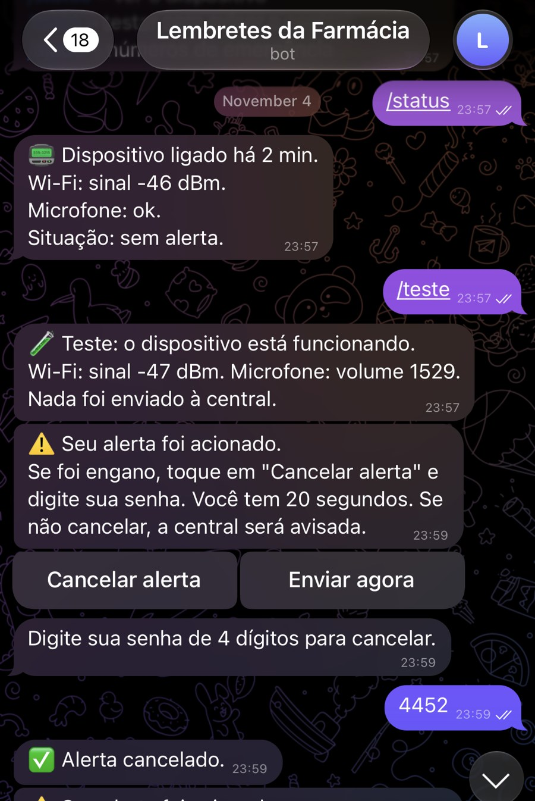
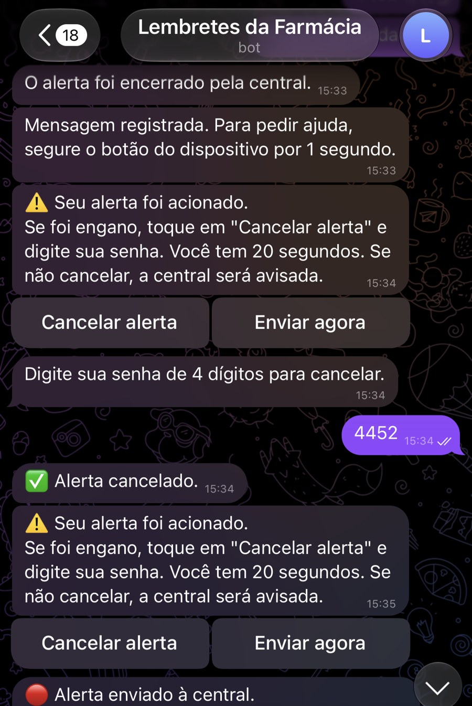
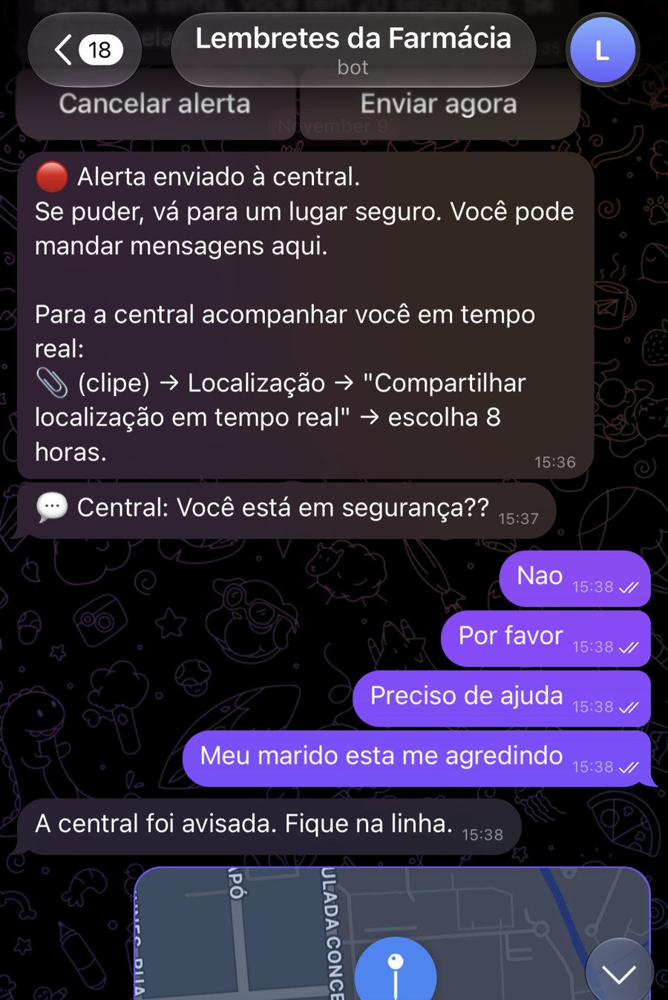

# HELP ME

**Dispositivo de alerta para vítimas de violência doméstica com ESP32.**

Projeto do TDE da disciplina **Conectividade em Sistemas Ciberfísicos**, curso de Engenharia de Software da PUCPR, 2026. Professor orientador: **Fábio Bettio**.

A usuária segura um botão por 1 segundo. O dispositivo vibra e abre um pré-alerta de 20 segundos no Telegram. Se ela não cancelar com a senha, a central de segurança recebe a ocorrência com áudio gravado, conversa e localização. O ESP32 é o **servidor HTTP na porta 80** que entrega a central para qualquer navegador da rede local.

<p align="center">
  
  
</p>

## Vídeo de demonstração

**[Assistir ao vídeo completo (2 min 54 s)](https://drive.google.com/file/d/1CQPIhX4oUAhRQfv2Jqt-ol8FbV0izJc4/view?usp=drivesdk)**

| Trecho | O que aparece |
|---|---|
| 0:06 a 0:54 | Montagem, microfone no Monitor Serial, motor, botão acionando o motor e teste integrado |
| 0:54 a 1:30 | Pré-alerta na central, Telegram da usuária, cancelamento com senha e novo acionamento |
| 1:36 a 1:54 | Ocorrência em andamento com dados da usuária, áudio gravado, chat e posição no mapa |
| 2:00 a 2:30 | Motor acionado pela central e acionamento da PM e do SAMU |
| 2:30 a 2:48 | Encerramento, histórico e estatísticas |

## Sumário

- [Equipe](#equipe)
- [Arquitetura](#arquitetura)
- [Hardware e pinagem](#hardware-e-pinagem)
- [Regras de funcionamento](#regras-de-funcionamento)
- [API do servidor](#api-do-servidor)
- [Clientes](#clientes)
- [Como executar](#como-executar)
- [Testes e evidências](#testes-e-evidências)
- [Estrutura do repositório](#estrutura-do-repositório)
- [Limitações e próximos passos](#limitações-e-próximos-passos)

## Equipe

| RA | Nome | Papel principal |
|---|---|---|
| 40132879 | Eduardo Hashimoto Yonegura | Hardware, protótipo, pesquisa de áudio, testes finais e vídeos |
| 40126989 | Gabriel André Moro | Pagamento das peças do projeto físico e do botão da case |
| 40126364 | Guilherme Sakagami Spitzner | Ajuda na montagem física do circuito |
| 40126944 | João Pedro Pires Antunes | Montagem do circuito, firmware, Telegram, software, testes finais, edição do vídeo, GitHub e relatório final |
| 40123207 | Letícia Beatriz Silva de Morais | Soldagem, interface web, documentação, case 3D, revisão do relatório e slides |

## Arquitetura

<p align="center"></p>

O sistema tem três partes:

- **Dispositivo:** ESP32 com botão e microfone (sensores) e motor de vibração (atuador). Roda o servidor HTTP, grava log, histórico e áudio na flash (LittleFS) e fala com o Telegram por HTTPS.
- **Central de segurança:** página web servida pelo próprio ESP32 na porta 80. Abre em qualquer navegador da mesma rede.
- **Canal da usuária:** bot do Telegram. O nome do bot é "Lembretes da Farmácia", um disfarce para que ninguém perto dela desconfie.

| Comunicação | Protocolo | Porta |
|---|---|---|
| Central ↔ ESP32 | HTTP sobre TCP | 80 |
| ESP32 → API do Telegram | HTTPS (TLS) sobre TCP | 443 |
| ESP32 → servidor NTP | NTP sobre UDP | 123 |

No ESP32, o trabalho é dividido em três tarefas do FreeRTOS: o laço principal (servidor HTTP, botão, motor e regras), a tarefa de áudio (núcleo 1) e a tarefa do Telegram (núcleo 0).

## Hardware e pinagem

| Componente | Pino do ESP32 | Função |
|---|---|---|
| ESP32 DevKit V1 | — | Processa, conecta ao Wi-Fi e roda o servidor |
| Botão (INPUT_PULLUP) | D22 | Sensor: segurar 1 s abre o alerta |
| Microfone digital INMP441 | D18 (SCK), D19 (WS), D21 (SD) | Sensor: mede o volume e grava o áudio |
| Motor de vibração 3 V + 2N2222A + resistor + diodo | D4 | Atuador: vibra para confirmar o acionamento |
| Alimentação | 3V3 e GND | Microfone e motor |

<p align="center">
  
  
</p>

A pinagem completa do ESP32 está no Apêndice A do [relatório](docs/Relatorio_HELP_ME_ABNT.pdf).

## Regras de funcionamento

<p align="center"></p>

| Regra | Comportamento |
|---|---|
| Disparo | Segurar o botão 1 s abre o alerta e o motor vibra uma vez. Toque curto é ignorado. |
| Pré-alerta | A usuária tem 20 s para cancelar pelo Telegram. Ela também pode tocar em "Enviar agora" e mandar antes do fim. |
| Senha normal | Cancela no pré-alerta. Depois do envio, vira pedido de encerramento para a central decidir. |
| Senha errada | Avisa e a contagem continua. Três erradas seguidas contam como coação. |
| Senha de coação | O celular mostra "Alerta cancelado", mas a central recebe em silêncio com prioridade máxima. Nada mais vai para o celular. |
| Som alto | Volume acima do limite por 1,5 s durante um alerta sobe a prioridade para máxima. Não dispara alerta nem liga o motor. |
| Áudio | Blocos de 60 s em WAV na flash. A central pode pedir mais 60 s. No falso alarme e no cancelamento, o áudio é apagado. |
| Localização | Só é aceita durante um alerta e é apagada quando ele termina. |
| Encerramento | Só a central encerra: atendimento concluído ou falso alarme. |
| Wi-Fi e log | Se a rede cair, o ESP32 tenta reconectar a cada 10 s. Todo evento vai para a flash com data, hora (NTP) e nível INFO, AVISO ou ERRO. |

## API do servidor

Todas as rotas usam `GET` na porta 80. Rota inexistente responde `404`.

| Rota | Resposta | O que faz |
|---|---|---|
| `/` | HTML | Página da central de segurança |
| `/status` | JSON | Estado, IP, MAC, rede, RSSI, tempo ligado, hora, alerta, Telegram e memória |
| `/sensor` | JSON | Volume do microfone, limite, som alto e estado do botão |
| `/atuador?estado=on\|off\|pulso` | JSON | Liga, desliga ou dá um pulso de 0,5 s no motor (desliga sozinho após 10 s) |
| `/limite?valor=N` | JSON | Ajusta o limite de som alto |
| `/simular` | JSON | Dispara um alerta de teste, como se o botão fosse apertado |
| `/resolver` | JSON | Encerra como atendimento concluído |
| `/falso` | JSON | Encerra como falso alarme |
| `/chat` | JSON | Conversa da ocorrência atual |
| `/chat/enviar?texto=...` | JSON | Envia mensagem da central para a usuária |
| `/audio?oc=CÓDIGO` | WAV | Áudio gravado da ocorrência |
| `/gravar_mais` | JSON | Grava mais 60 s de áudio |
| `/localizacao?desde=N` | JSON | Pontos novos da localização e status |
| `/pedir_localizacao` | JSON | Pede a localização em tempo real pelo Telegram (bloqueado em coação) |
| `/historico` | JSON | Últimas ocorrências |
| `/estatisticas` | JSON | Números calculados do histórico |
| `/log?ultimas=N` | Texto | Últimas linhas do log da flash |
| `/log/limpar` | JSON | Limpa o log |

Exemplo:

```bash
curl http://172.20.10.12/status
curl "http://172.20.10.12/atuador?estado=pulso"
```

## Clientes

- **Navegador (central de segurança):** abre `http://IP_DO_ESP32/` e mostra visão geral, ocorrência em andamento, áudio, chat, mapa, acionamento da PM (190) e do SAMU (192) simulados, dispositivo em tempo real, histórico, estatísticas e log.
- **Telegram (usuária):** comandos `/start`, `/status`, `/teste` e `/ajuda`, e os botões "Enviar localização atual", "Estou bem" e "Preciso de ajuda". Durante o alerta, o que ela escreve aparece no chat da central.
- **Scripts de teste ([src/client](src/client)):** testam ping, porta 80, rotas, 404, atuador e 100 requisições seguidas, no Windows (PowerShell) e no macOS/Linux (bash).

<p align="center">
  
  
  
</p>

## Como executar

### Requisitos

- ESP32 DevKit V1 montado como na seção [Hardware e pinagem](#hardware-e-pinagem)
- [Arduino IDE 2](https://www.arduino.cc/en/software) com o pacote de placas **esp32** da Espressif
- Biblioteca **ArduinoJson** 7.x (Benoit Blanchon), instalada pelo Library Manager
- Rede Wi-Fi de **2,4 GHz** com acesso à internet (o Telegram e o NTP precisam dela)
- Um bot do Telegram criado no [@BotFather](https://t.me/BotFather) e o `chat_id` da usuária

### Configuração

No início de [`src/esp32/helpme_final_v3/helpme_final_v3.ino`](src/esp32/helpme_final_v3/helpme_final_v3.ino):

```cpp
const char* WIFI_SSID        = "NOME_DA_REDE";
const char* WIFI_SENHA       = "SENHA_DA_REDE";
const char* TELEGRAM_TOKEN   = "SEU_TOKEN_AQUI";
const char* CHAT_ID_USUARIA  = "7107756741";
const char* SENHA_CANCELAR   = "4452";
const char* SENHA_COACAO     = "2544";
```

Troque `NOME_DA_REDE`, `SENHA_DA_REDE` e `SEU_TOKEN_AQUI` pelos dados reais antes de gravar. O token vem do @BotFather, e o `CHAT_ID_USUARIA` é o chat da usuária que o bot aceita. As senhas 4452 (cancelar) e 2544 (coação) são as da demonstração.

### Gravação

1. **Tools › Board:** `ESP32 Dev Module`
2. **Tools › Partition Scheme:** `No OTA (2MB APP/2MB SPIFFS)` (reserva 2 MB para o LittleFS)
3. Grave o sketch e abra o **Serial Monitor** em **115200**
4. O Monitor Serial mostra o IP. Abra `http://IP_DO_ESP32/` em um navegador da mesma rede
5. No Telegram, mande `/start` para o bot

## Testes e evidências

Os testes foram feitos em duas rodadas: a primeira em 16/10/2026 (rede e servidor) e a segunda em 09/11/2026 (versão final, com o ESP32 em `172.20.10.12` e o computador de teste em `172.20.10.14`).

| Teste | Resultado | Evidência |
|---|---|---|
| Inicialização | Wi-Fi, servidor na porta 80, microfone e hora sem reiniciar | [01_boot_serial](docs/evidencias/versao_final/01_boot_serial.png) |
| Ping | 4 de 4 respostas, 0% de perda, média de 38,6 ms | [02_ping](docs/evidencias/versao_final/02_ping.png) |
| Porta 80 | Conexão TCP aceita | [03_porta80](docs/evidencias/versao_final/03_porta80.png) |
| Cliente-servidor | JSON em `/status` e nas rotas de dados, 404 em rota inexistente | [04](docs/evidencias/versao_final/04_curl_status.png), [05](docs/evidencias/versao_final/05_curl_rotas_404.png) |
| Atuador pela rede | Motor liga e desliga; desligamento automático após 10 s no log | [06](docs/evidencias/versao_final/06_motor_pela_rede.png), [07](docs/evidencias/versao_final/07_log_central.png) |
| Pré-alerta e cancelamento | Contagem de 20 s; senha errada avisada; senha certa cancela | [08](docs/evidencias/versao_final/08_pre_alerta.png), [Telegram](docs/evidencias/telegram) |
| Atendimento | Chat nos dois sentidos, áudio e localização na central | [09](docs/evidencias/versao_final/09_chat_central.png), [10](docs/evidencias/versao_final/10_mapa.jpg) |
| Coação | Celular mostra "cancelado" | [05_coacao](docs/evidencias/telegram/05_coacao.jpg) |
| Histórico | 8 ocorrências, tempo médio de resposta de 1 min 00 s | [11](docs/evidencias/versao_final/11_historico.png), [12](docs/evidencias/versao_final/12_estatisticas.png) |
| Queda do Wi-Fi | Reconexão automática registrada no log | [07_queda_reconexao_wifi](docs/evidencias/primeira_rodada/07_queda_reconexao_wifi.jpg) |
| Reinício | Log mantido na flash | [08_log_apos_reiniciar](docs/evidencias/primeira_rodada/08_log_apos_reiniciar.jpg) |
| Estresse | 100 requisições seguidas sem erro | [09_estresse_100_requisicoes](docs/evidencias/primeira_rodada/09_estresse_100_requisicoes.jpg) |

O roteiro completo, com os 34 passos e o resultado esperado de cada um, está em [docs/HELP_ME_Funcoes_e_Fluxo_de_Testes.pdf](docs/HELP_ME_Funcoes_e_Fluxo_de_Testes.pdf).

## Estrutura do repositório

```
HELP-ME/
├── README.md
├── docs/
│   ├── Relatorio_HELP_ME_ABNT.pdf
│   ├── Relatorio_HELP_ME_ABNT.docx
│   ├── HELP_ME_Funcoes_e_Fluxo_de_Testes.pdf
│   ├── img/                     arquitetura, ligações, estados, pinagem, protótipo, central e quadros do vídeo
│   └── evidencias/
│       ├── primeira_rodada/     testes de 16/10/2026
│       ├── versao_final/        testes de 09/11/2026
│       └── telegram/            prints do canal da usuária
└── src/
    ├── esp32/helpme_final_v3/   firmware (Arduino IDE)
    └── client/                  scripts de teste da central (PowerShell e bash)
```

## Limitações e próximos passos

- O protótipo funciona ligado ao USB, sem bateria.
- A central não tem login: qualquer aparelho da rede local pode abri-la.
- A conexão com o Telegram não verifica o certificado do servidor, o que só serve para protótipo.
- A flash comporta poucos minutos de áudio.
- O alerta só chega ao Telegram se o Wi-Fi tiver acesso à internet.
- Os dados cadastrais das usuárias na central são fictícios.

Próximos passos: bateria, login na central, verificação do certificado TLS e detecção automática de gritos pelo microfone.

## Documentação

- [Relatório técnico (ABNT), PDF](docs/Relatorio_HELP_ME_ABNT.pdf)
- [Relatório técnico (ABNT), DOCX](docs/Relatorio_HELP_ME_ABNT.docx)
- [Funções e fluxo de testes](docs/HELP_ME_Funcoes_e_Fluxo_de_Testes.pdf)
- [Vídeo de demonstração](https://drive.google.com/file/d/1CQPIhX4oUAhRQfv2Jqt-ol8FbV0izJc4/view?usp=drivesdk)
